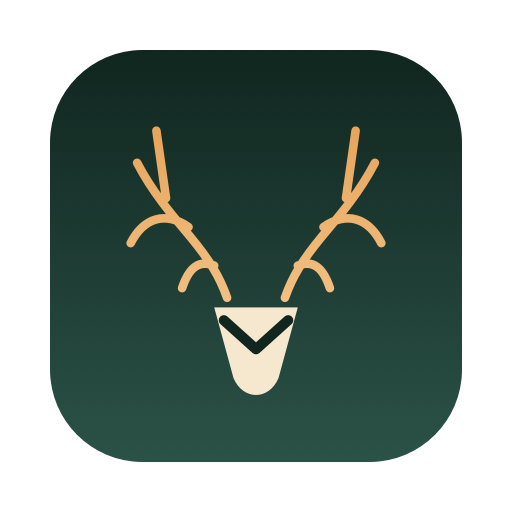
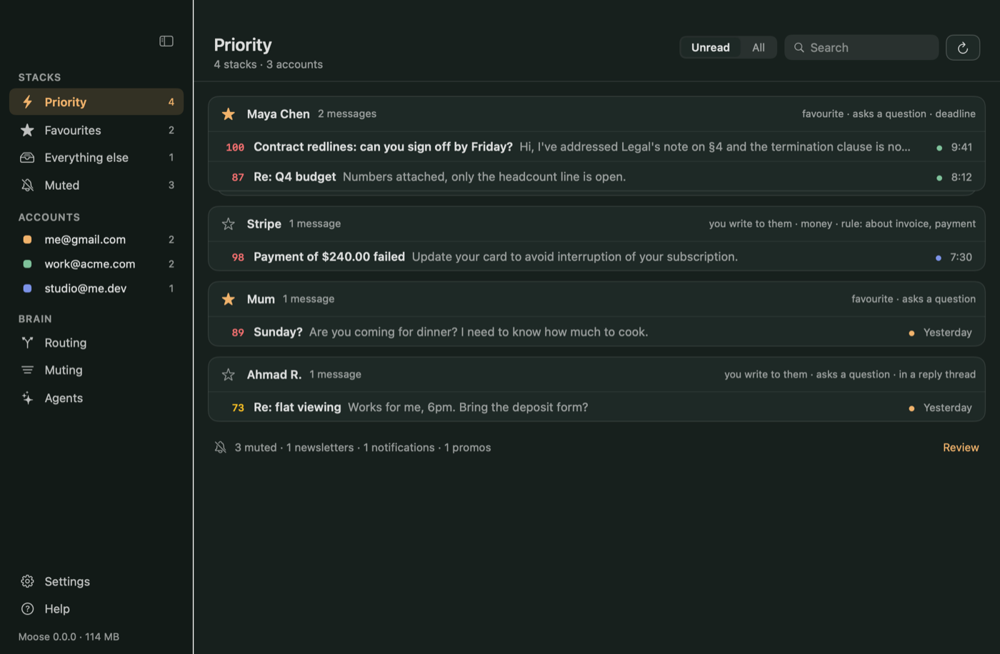
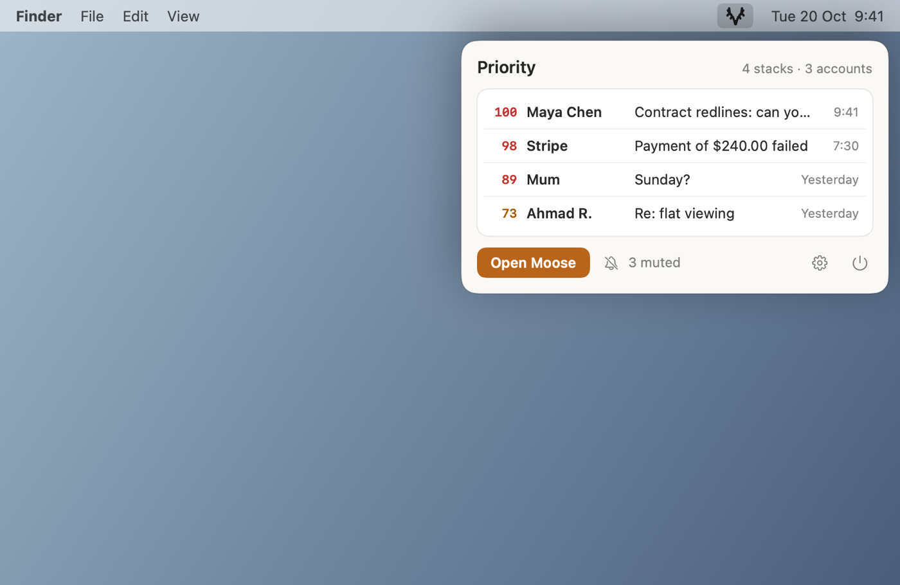
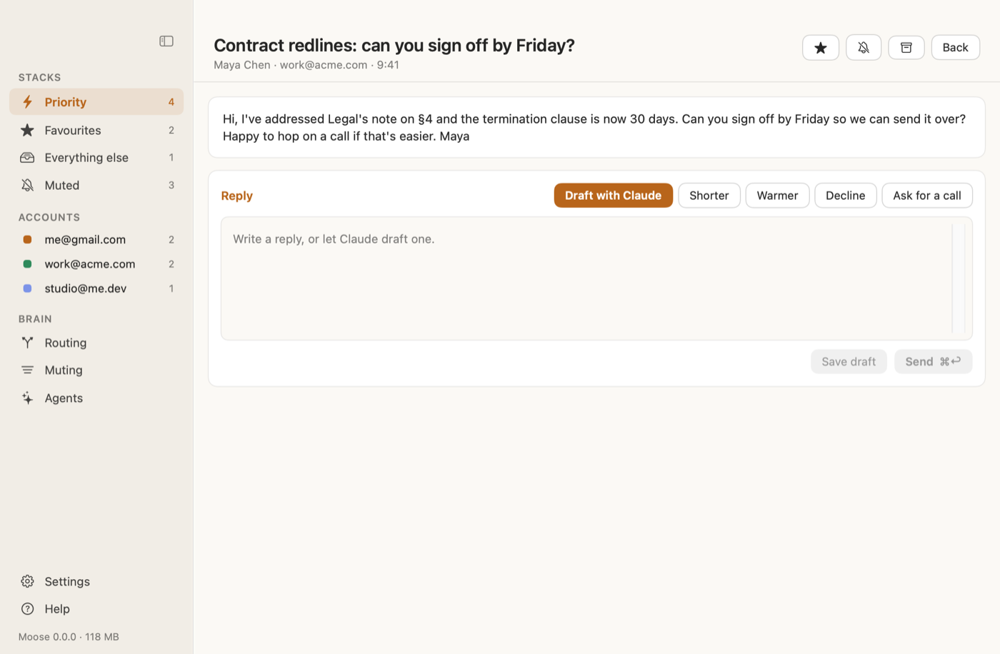
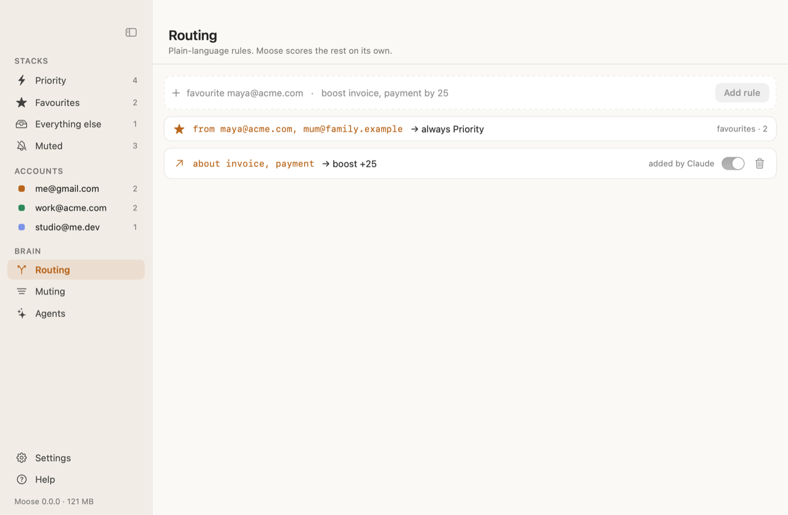
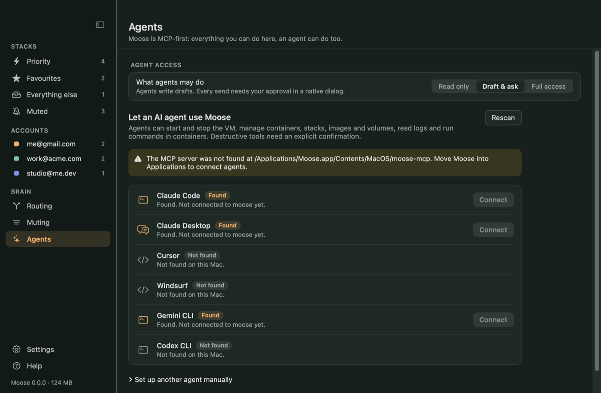

<p align="center"></p>
<h1 align="center">Moose</h1>
<p align="center"><b>Gmail without the noise.</b> A native, text-only, stacked, multi-account mail client for the Mac menu bar, built to be driven by AI agents.</p>

<p align="center"></p>

## Install with an AI agent

Paste this into an AI coding agent such as Claude Code. Moose detects and installs its own prerequisites on first launch, so the agent does not have to:

```text
Install Moose on this Mac.
1. Run: curl -fsSL https://raw.githubusercontent.com/kalahroudi/moose/main/scripts/install.sh | bash
2. Moose opens its first-run guide. Moose is open source and ships no shared Google keys, so I create my own
   Google sign-in client once: the guide opens the exact Google Cloud pages and imports the downloaded
   client_secret_*.json by itself. Tell me which page to click through and wait until the guide shows my
   Gmail account as connected. If a step needs my password, tell me the exact command to run in Terminal.
3. Register its MCP server: claude mcp add moose --scope user -- /Applications/Moose.app/Contents/MacOS/moose-mcp
4. Call get_status and tell me what it reports.
Never call a destructive tool without asking me first.
```

## What it is

- **Stacked.** One card per sender, across all your Gmail addresses, ranked together.
- **Priority assessment.** Every message gets a transparent 0–100 score from signals on your Mac: favourites, people you write to, questions, deadlines, money, security notices, unread, recency. The *why* is shown next to each stack.
- **Noise free.** Newsletters, promos and automated mail are muted (never deleted). Text only: HTML is stripped and images and tracking pixels are never loaded.
- **Smart routing.** Plain-language rules: `favourite maya@acme.com`, `mute newsletters, promos`, `boost invoice, payment by 25`.
- **Favourite stacking.** Star a sender and they always rank high and are never auto-muted.
- **MCP-first.** `moose-mcp` ships inside the app. Everything you can do in the window, an agent can do. You decide how much: *Read only*, *Draft & ask* (every send needs your approval in a native dialog) or *Full access* (sends after an undo window).
- **Replies with Claude.** "Draft with Claude" runs your own Claude Code CLI headless, in your voice, with no tools enabled. Moose stores no API key.
- **Light.** Pure Swift (SwiftUI + AppKit), zero dependencies. Nothing polls while the window and popover are closed; closing them frees their views.

| Menu bar | Reply with Claude |
|---|---|
|  |  |
| **Routing** | **Agents** |
|  |  |

(Screenshots use made-up sample data.)

## Setup: bring your own Google client

Moose is open source, so it can't ship a shared Google sign-in key. You create your own once (about two minutes), and your mail never passes through anyone else's project. The first-run guide does it for you as far as Google allows:

1. **Enable the Gmail API**, **create a "Desktop app" OAuth client** and **Publish the app** (otherwise Google expires sign-ins every 7 days; personal use needs no review). The guide opens each exact page.
2. Press *Download JSON*. Moose watches `~/Downloads`, imports `client_secret_*.json` into your Keychain and moves the file to the Trash. (Or paste the ID and secret.)
3. *Sign in with Google* for each address. Tokens live in the Keychain.

Google has no API for creating a Desktop client, so step 1 needs your clicks. Everything else is automatic.

Requires macOS 14+. Claude drafting needs [Claude Code](https://claude.com/claude-code) (`brew install --cask claude-code`); the guide offers to install it.

## Install

```sh
curl -fsSL https://raw.githubusercontent.com/kalahroudi/moose/main/scripts/install.sh | bash
```

or download the DMG from [Releases](https://github.com/kalahroudi/moose/releases). Build from source:

```sh
swift build && swift test && scripts/bundle.sh && open dist/Moose.app
```

## MCP tools

`get_status` · `list_stacks` · `search_messages` · `list_rules` · `read_message` · `sync_mail` · `mark_read` · `archive_message` · `set_favourite` · `mute_sender` · `create_rule` · `delete_rule` · `draft_reply` · `send_reply`

Connect agents from **Agents** in the sidebar (Claude Code, Claude Desktop, Cursor, Windsurf, Gemini CLI, Codex CLI), or manually:

```sh
claude mcp add moose --scope user -- /Applications/Moose.app/Contents/MacOS/moose-mcp
```

Read tools work from the local cache even when the app is closed. Everything that touches Gmail goes through the running app (the only process that holds tokens) over loopback with a bearer token, and the app enforces your Agent access setting. Email text is passed to agents as untrusted data. See [`skills/moose/SKILL.md`](skills/moose/SKILL.md).

## Privacy and safety

- Scope: `gmail.modify` (read, label, drafts, send). Moose never permanently deletes mail.
- Tokens and your Google client secret: Keychain only. Mail cache: `~/Library/Application Support/Moose/` (headers and Gmail's text snippets; full text is fetched on demand and not stored). Uninstall = delete that folder.
- No analytics, no servers of ours. The only network traffic is to Google (and to Anthropic through your own Claude CLI when you ask for a draft).
- Errors show one plain sentence; the details go to `app.log` (Settings → About → Show log).

## Status

v0.1. The scoring, stacking, rules, MIME handling, OAuth/PKCE, send policy, scrubber and persistence have unit tests (`swift test`). The Gmail and Google sign-in paths are written against Google's documented REST API but have so far been exercised only by their parsing and request-building code; please open an issue if a real account misbehaves.

## License

Apache-2.0
